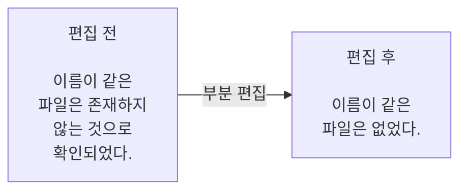

# HMY Blog Writing

AI와 함께 한국어 블로그 글을 쓰고 다듬을 때 사용하는 스킬입니다.

블로그 초안을 부탁했는데 보고서처럼 딱딱한 글이 나오는 문제에서 출발했습니다. 어색한 문장과 문단은 고치되, 원래 글의 사실과 경험은 남기고 잘 읽히는 문장은 그대로 두도록 만들었습니다. 일상 기록, 후기, 에세이, 기술 설명 등 여러 글에 사용할 수 있습니다.

## 설치

Node.js와 Git이 설치된 환경에서 작업할 프로젝트 폴더를 열고 실행하세요.

```sh
npx skills add HoMongYi/hmy-blog-writing
```

설치할 도구를 선택한 뒤 새 세션에서 스킬을 불러오면 됩니다. 같은 스킬을 직접 수정해 사용 중이라면 설치 전에 복사해 두세요.

| 도구 | 설치 위치 | 불러오기 |
| --- | --- | --- |
| [Claude Code](https://code.claude.com/docs/en/skills) | `.claude/skills/hmy-blog-writing` | `/hmy-blog-writing` |
| [OpenAI Codex](https://developers.openai.com/codex/skills/) | `.agents/skills/hmy-blog-writing` | `$hmy-blog-writing` |

## 적용하면 어떻게 달라지나요?

아래는 합성 원고로 실행한 부분 편집 테스트의 입력과 결과입니다. Codex에 스킬 문서와 필요한 참조를 직접 제공해 실행했습니다.



파일 수 12개, 소요 시간 3분, 목록을 다시 확인한 행동은 그대로 남았습니다. 첫 문장과 마지막 문장도 바꾸지 않았습니다.

<details>
<summary>전체 원문과 편집 결과 보기</summary>

**편집 전**

> 가상 테스트 기록에서 파일 수는 12개였다. 파일명 변경은 3분이 소요되었으며, 변경이 완료된 이후 목록을 다시 확인하는 작업을 진행했다. 이름이 같은 파일은 존재하지 않는 것으로 확인되었다. 원래 이름을 적어 둔 메모는 남겨 뒀다.

**편집 후 — 실제 실행 결과**

> 가상 테스트 기록에서 파일 수는 12개였다. 파일명 변경에는 3분이 걸렸고, 변경을 마친 뒤 목록을 다시 확인했다. 이름이 같은 파일은 없었다. 원래 이름을 적어 둔 메모는 남겨 뒀다.

</details>

## 이렇게 요청해 보세요

스킬을 불러온 뒤, 쓰려는 글이나 고칠 원고를 함께 보내세요. 메모만 있어도 시작할 수 있습니다.

**새 글을 쓸 때**

```text
첨부한 메모로 주말 산책 기록을 써줘.
개인 블로그에 올릴 짧은 글이면 좋겠어.
```

**일부 문장만 고칠 때**

```text
아래 원고에서 보고서처럼 딱딱한 부분만 다듬어줘.
전체를 다시 쓰지는 말고.

[원고]
```

**자료를 찾아 설명할 때**

```text
USB-C 단자의 모양만 보고 지원 기능을 알 수 있는지 설명해줘.
독자는 노트북 주변기기를 고르는 사람이야.
직접 써 본 경험은 없으니 공식 자료를 찾아서 써줘.
```

원고를 바꾸기 전에 의견만 받고 싶다면 “수정하지 말고 어색한 부분과 이유만 알려줘”라고 요청하면 됩니다. [집필 예시](examples/writing-example.md)와 [편집 예시](examples/editing-example.md)도 참고할 수 있습니다.

## 글을 다루는 방식

사용자가 적어 준 경험을 바탕으로 씁니다. 기록에 없는 구매 이유나 감정, 실패담을 보태지 않습니다. 자료를 찾아 쓰는 글에서는 확인한 사실과 그에 대한 의견을 구분합니다.

문단은 화제가 바뀌거나 설명이 길어져 읽기 어려울 때 나눕니다. 문장 수를 맞추려고 자르거나, 모든 문단을 조언과 교훈으로 끝내지는 않습니다.

출처는 독자가 확인할 필요가 있는 곳에 연결합니다. 안전 조건이나 제품 규격의 근거는 가까이 두고, 보조 자료는 참고자료로 옮길 수 있습니다. 개인적인 기억이나 취향에까지 외부 문서를 붙이지는 않습니다.

## 사용 전에 알아둘 점

웹 검색과 파일 읽기는 사용하는 도구에서 제공해야 합니다. 이 스킬에는 Ghost를 비롯한 CMS의 저장·발행 기능이 없습니다.

Claude Code와 Codex용 파일 설치를 확인했습니다. 모델 실행은 Codex에 지침을 직접 제공한 짧은 테스트로 확인했으며, 자동 스킬 호출과 Claude Code의 모델 실행은 아직 검증하지 않았습니다. 자세한 확인 범위와 평가 방법은 [평가 문서](evals/behavior-evals.md)에 있습니다.

<details>
<summary>파일 구성</summary>

| 파일 | 내용 |
| --- | --- |
| `SKILL.md`, `VERSION` | 스킬의 실행 지침과 버전 |
| `agents/openai.yaml` | Codex 표시 정보와 호출 설정 |
| `references/voice-and-flow.md` | 문체와 문단 구성 |
| `references/evidence-and-sources.md` | 경험, 사실, 출처 처리 |
| `references/article-types.md` | 글의 목적에 맞는 구성 예시 |
| `references/visuals-and-ghost.md` | 이미지와 기존 콘텐츠 보존 |
| `references/review-checklist.md` | 원고 검토 항목 |
| `examples/` | 합성 자료로 만든 집필·편집 예시 |
| `evals/behavior-evals.md` | 평가 방법과 테스트 범위 |

</details>

## 라이선스와 참고한 프로젝트

[MIT License](LICENSE)로 배포합니다. 현재 버전은 **0.0.1**이며 변경 내역은 [CHANGELOG.md](CHANGELOG.md)에 있습니다.

한국어 교정과 스킬 구성 방식을 검토하면서 아래 프로젝트를 참고했습니다. 코드, 패턴 목록, 예문, 문서 본문을 복제해 포함한 부분은 없습니다.

- [DaleSeo/korean-skills](https://github.com/DaleSeo/korean-skills) — [MIT](https://github.com/DaleSeo/korean-skills/blob/main/LICENSE)
- [epoko77-ai/im-not-ai](https://github.com/epoko77-ai/im-not-ai) — [MIT](https://github.com/epoko77-ai/im-not-ai/blob/main/LICENSE)
- [getsentry/skills](https://github.com/getsentry/skills) — [Apache-2.0](https://github.com/getsentry/skills/blob/main/LICENSE)
- [Anbeeld/WRITING.md](https://github.com/Anbeeld/WRITING.md) — [MIT](https://github.com/Anbeeld/WRITING.md/blob/main/LICENSE)

각 프로젝트의 저작권과 라이선스는 해당 저작자에게 있습니다.
